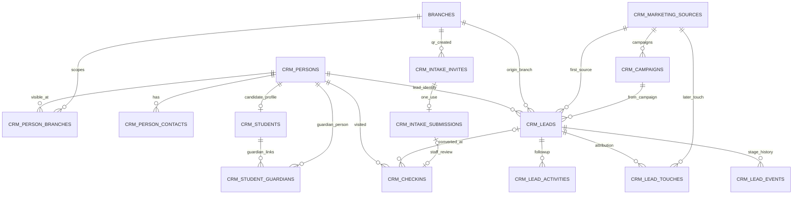

# Stage 02 CRM – Domain ERD

> 14 new CRM tables, coexisting with Stage 01 SaaS Core. Composite foreign keys in migration bind every operational relationship to `tenant_id`. `platform_users` and `branches` belong to Stage 01.

## Modeling notes

- `crm_persons` is an identity within a tenant; `crm_students` is a *student profile* established at check-in. This does **not** mean active paid enrollment.
- `crm_person_branches` defines visible branch associations; branch-level permissions are enforced by backend service before queries.
- `crm_leads.qualified_at` is first qualification timestamp; current QL is based on a valid contact phone.
- Contacts/phones are **not unique**: one guardian phone can relate to several students, and matching a phone is only a duplicate suggestion.
- `crm_lead_touches` keeps source history; `crm_leads.source_id` retains first acquisition source; check-in source can be independently set.
- `crm_intake_submissions` stores only provisional data. Staff review is required before Person Master changes.
- Status `crm_persons.status=CUSTOMER` means reached point of sale, not an enrolled/paid student.
- Use `person_id` as the durable key into future Assessment, Contracts, LMS and Renewal domains.
