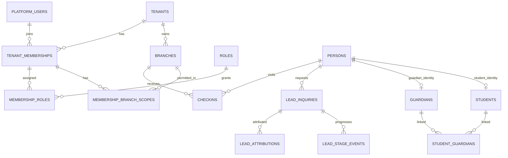
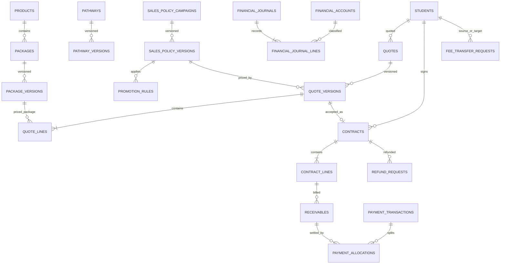
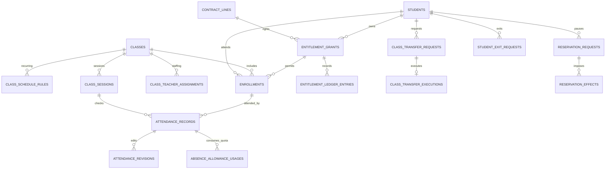
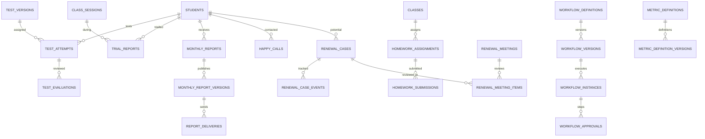
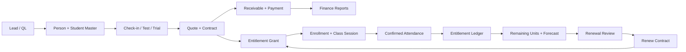

# ERD v1.0 – Các sơ đồ quan hệ trọng tâm

Đây là **logical diagrams**, giản lược thuộc tính (danh mục bảng/cột đầy đủ nằm trong `ERD_v1.md`). Mọi liên kết giữa hai bảng `[T]` phải thêm `tenant_id` vào composite FK.

## A. SaaS / Identity / CRM

## B. Sản phẩm / CSBH / Bán hàng / Tài chính

## C. Lớp / Điểm danh / Số buổi / Bảo lưu

## D. LMS / CSKH / Duyệt / BI

## E. Dòng dữ liệu chính (logic event flow)

